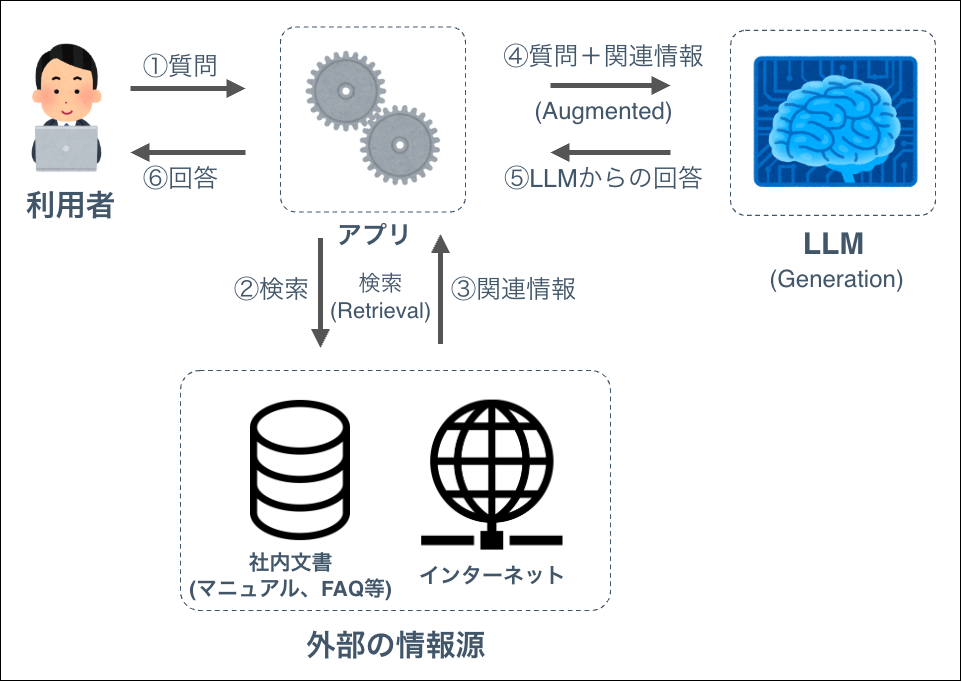
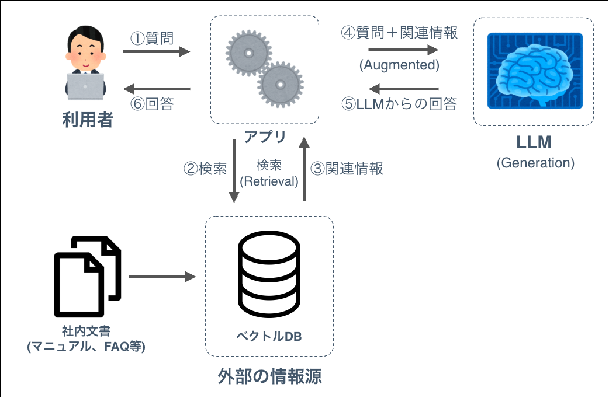
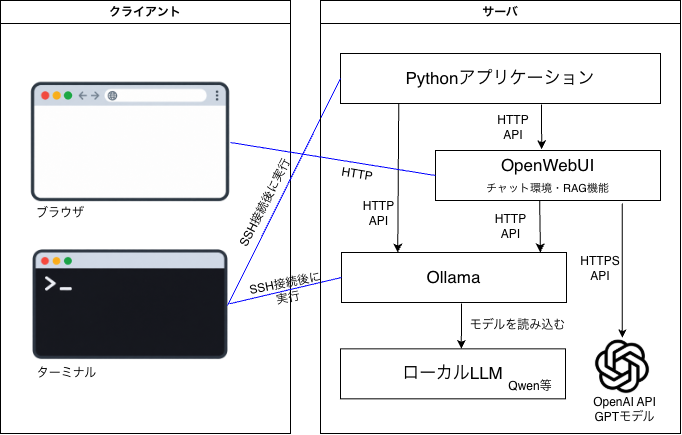
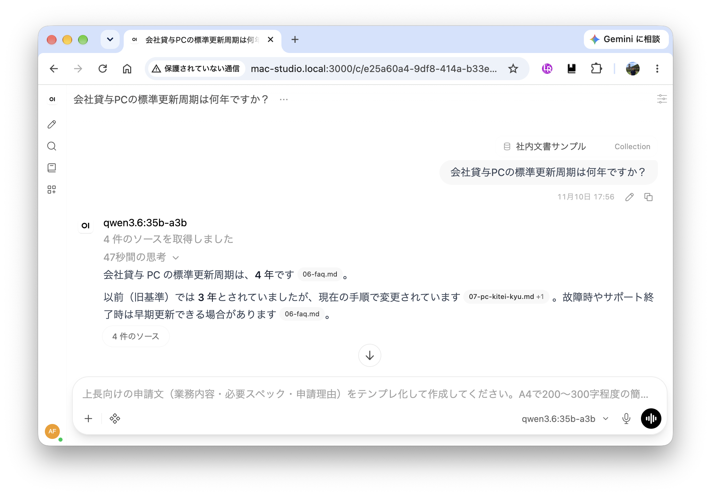
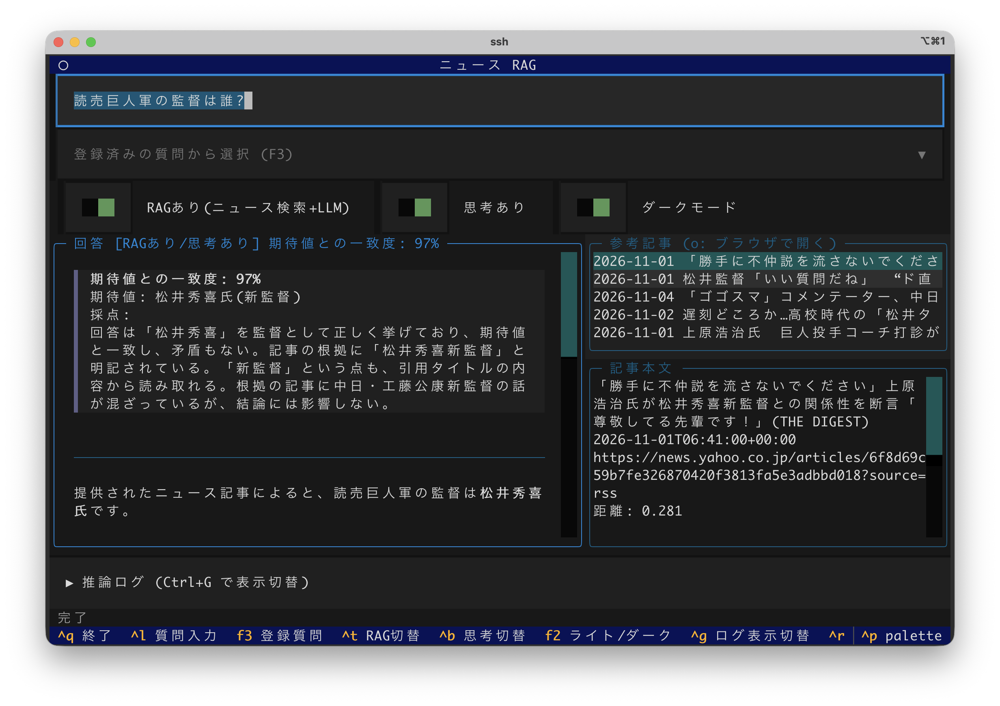
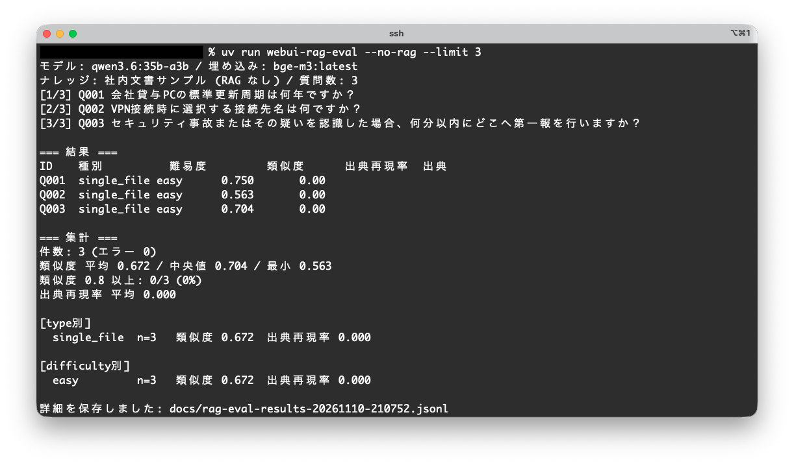
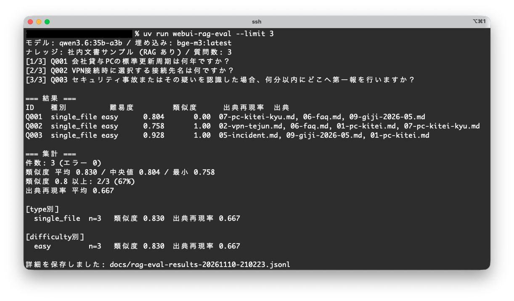
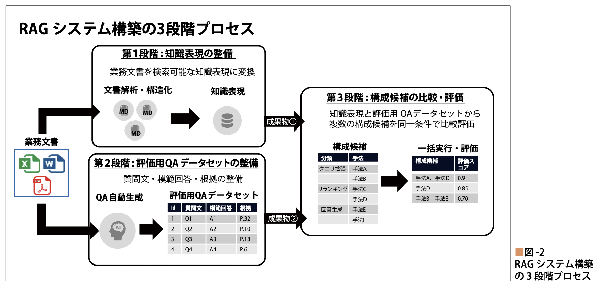
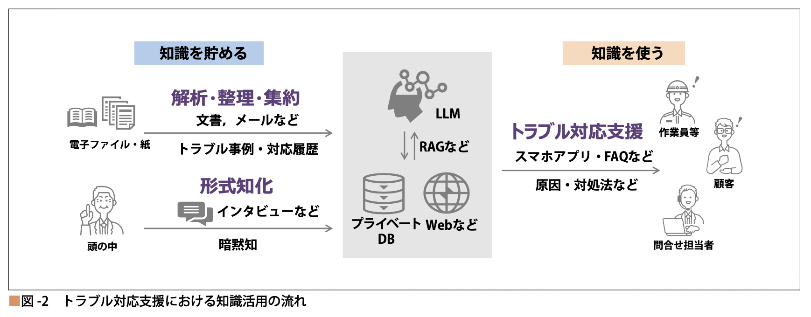
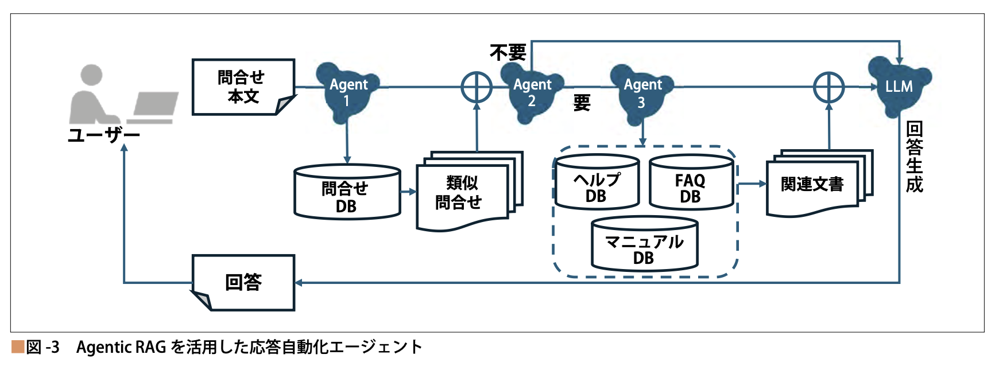

# ローカルLLMとRAGを使った文書検索の実践

## 1. RAGとは

### 1-1. ローカルLLMの限界

ローカルLLMで以下のような質問をしてみる。

```
「沖縄県知事は誰？」→「玉城デニー」
「読売巨人軍の監督は誰？」→「原辰徳」
```

いずれも間違い。
最新の情報を保有していないのが原因。

### 1-2. コンテキストの工夫

次にプロンプトに情報を追加し、同じ質問をしてみる。

```
＜コンテキスト＞
2026年9月13日に投開票された沖縄県知事選挙で、前那覇市副市長の古謝玄太氏が初当選を果たした。3期目を目指していた現職の玉城デニー氏を破り、県政の刷新を訴えた新人候補が県民の支持を集めた。古謝氏は東京大学卒業後、総務省などで勤務し、2022年から那覇市副市長を務めていた。今回の選挙では経済振興や基地問題などが主な争点となった。
＜質問＞
沖縄県知事は誰？
```

→「古謝玄太」

### 1-3. RAG

```
Retrieval-Augmented Generation
^^^^^^^^^ ^^^^^^^^  ^^^^^^^^^^
 (検索)　　 (拡張)　　　(生成)
```

各種情報が含まれるデータベースから、質問に該当するものを複数ピックアップし（**検索**）、それをコンテキストに加える（**拡張**）ことで、より正確に回答（**生成**）できるようにする技術。



## 2. RAGの基本

各種文書を類似度検索ができるようにベクトル化して、DBに保存するという事前準備が必要となる。



## 3. 実験環境



### サーバ側

- OllamaでQwen等のローカルLLMを実行
- OpenWebUIでQwenやOpenAI API経由でGPTモデルに接続しチャット環境構築 (a)
- PythonからOllama経由でQwenに接続してRAGアプリ作成 (b)
- PythonからOpenWebUIに接続してRAGアプリ作成 (c)


#### Ollama

Ollamaのインストールや設定
```bash
# ollamaをインストール
$ brew install ollama
# モデルを取得
$ ollama pull qwen3.6:35b-a3b
# サービス開始
$ brew services start ollama
# サービス停止
$ brew services stop ollama
# 再起動
$ brew services restart ollama
# 状態確認
$ brew services list
```
起動確認
```bash
curl http://localhost:11434/api/tags
```

#### OpenWebUI

docker用のyamlファイルを準備する。
```yaml
services:
  open-webui:
    image: ghcr.io/open-webui/open-webui:main
    container_name: open-webui
    ports:
      - "3000:8080"
    environment:
      - OLLAMA_BASE_URL=http://host.docker.internal:11434
    volumes:
      - open-webui:/app/backend/data
    restart: unless-stopped

volumes:
  open-webui:
```

サーバを起動する
```bash
$ docker compose -f compose.yml up
```

### クライアント側

- SSHでサーバに接続し、Ollama CLIを利用してチャット
- ブラウザからOpenWebUIに接続してチャット(a)
- SSHでサーバに接続し、Ollama経由のRAGアプリ(b)
- SSHでサーバに接続し、OpenWebUI経由のRAGアプリ(c)

## 4. 実験

### 4-1. [Ollama CLIの利用](0401_ollama.md)

> [!NOTE] 
> ターミナル→(SSH)→Ollama CLI→ローカルLLM

Ollama CLIを用いたチャットや要約の機能。

- Ollama CLIでチャット
  巨人の監督は「野村謙二郎」と主張している。→ハルシネーション（幻覚）![[ollama_cli1_cut.png]]

- Ollama CLIで要約
```bash
$ ollama run qwen3.6:35b-a3b \
> "このテキストの内容を要約して" \
> < 走れメロス.txt
```
出力は以下となる。
```bash
太宰治『走れメロス』の要約は以下の通りです。

**【物語の概要】**
牧人の子メロスは、邪智暴虐な王ディオニスを討つ決意を持って都へ赴くが、直前に捕らえられる。処刑を前にし、メロスは妹の結婚式参加のために3日間の猶予を懇願する。その担保として竹馬の友セリヌンティウスを生け贄（身代り）に出す約束をし、王はこれを承諾する（信実が虚しいものであることを世に示す機会と受け取っている）。

（省略）

**【主題・メッセージ】**
本作品は、言葉や制度を超えた人間同士の純粋な信頼関係が持つ絶対的な力と、「約束を守ること」への信念がどれほど人間の限界を越えさせ、悪も善へ転じさせるかを描いた寓話的傑作です。太宰治自身が「人類の兄弟愛」「信実の尊さ」をテーマとして掲げた作品であり、現代読者にも普遍的な感動を与え続けています。
```

### 4-2. [架空の社内文書を用いたRAG](0402_OpenWebUI.md)

> [!NOTE]
> ブラウザ→OpenWebUI→Ollama→ローカルLLM / GPTモデル

OpenWebUIを用いることで、複数のローカルLLMやGPTモデルを利用することができる。PDF等の書類をワークスペースに追加することで、RAG環境も簡単に構築することが可能となる。


**ChatGPTを用いて架空の社内文書を作成**
書籍「社内で動かすローカルLLM」を参考に、ChatGPTを使用して架空の社内文書を9本作成した。

＜プロンプト＞
```
以下のような架空の会社の社内文書を作成してほしい。目的はRAGの評価をするため。チャンク400、オーバーラップ50で設定する予定。RAGで質問するときには、単一の文書で回答できるものと、2ファイル以上を参照しないと回答できないものを用意したいので、それを前提とした文書を作成してほしい。
```

| ファイル               | 中身               | 特記事項            |
| ------------------ | ---------------- | --------------- |
| [01-pc-kitei.md](docs/社内文書/01-pc-kitei.md)     | PC貸与規定（新版）       | 全編の基準となる文書      |
| [02-vpn-tejun.md](docs/社内文書/02-vpn-tejun.md)    | リモート接続の手順書       | 手順に順序がある        |
| [03-account.md](docs/社内文書/03-account.md)      | アカウント発行・停止の基準    | 条件によって扱いが分かれる   |
| [04-shinsei.md](docs/社内文書/04-shinsei.md)      | ソフトウェア・機器購入申請規定  | 金額で承認者が変わる      |
| [05-incident.md](docs/社内文書/05-incident.md)     | セキュリティ事故報告の手順    | 誰に何分以内に報告するかが明確 |
| [06-faq.md](docs/社内文書/06-faq.md)          | よくある問い合わせ30件     | 1件ごとの記述が短い      |
| [07-pc-kitei-kyu.md](docs/社内文書/07-pc-kitei-kyu.md) | 旧版のPC貸与規定        | 新版と数値が食い違う      |
| [08-kishu-hyo.md](docs/社内文書/08-kishu-hyo.md)    | 貸与PCの機種と割り当て基準の表 | 基準を記載           |
| [09-giji-2026-05.md](docs/社内文書/09-giji-2026-05.md) | 情シス定例の議事録        | 発言の中に運用の指示が混じる  |

**評価用のQAを作成**

さらに、[RAG評価用の質問と模範回答と回答根拠ファイル](docs/社内文書評価用QA/)を30問作成した。以下は、質問の具体例。

```
例1：単一文書で回答できる質問

[質問]
会社貸与PCの標準更新周期は何年ですか？

[模範回答]
貸与開始日から4年です。故障、修理不能、セキュリティサポート終了、業務要件の変更などの場合は、4年未満でも更新できることがあります。

[正解根拠]
01-pc-kitei.md

[評価ポイント]
該当する規定を検索し、更新周期と例外条件を正しく取得できるかを確認します。
```

```
例2：複数文書を参照する質問

[質問]
営業担当者が月次データ分析を定常的に行い、複数の分析アプリを同時利用しています。どのPC機種を候補にでき、機種決定では何を確認する必要がありますか？

[模範回答]
L-14Mを候補として申請できます。上長がデータ分析業務と複数アプリの同時利用という業務要件を説明し、情報システム部が最終的な機種を決定します。

[正解根拠]
- 01-pc-kitei.md
- 08-kishu-hyo.md

[評価ポイント]
PC貸与規定だけでは具体的な機種の判断が難しく、機種割り当て表だけではPC貸与に関する全体的なルールが分かりません。

両方の文書を検索し、機種と承認条件を組み合わせて回答できるかを評価します。
```

### 4-3. ニュース記事を用いたRAG

> [!NOTE]
> ターミナル→(SSH)→Pythonアプリケーション→Ollama→ローカルLLM

[YahooニュースのRSSフィード](https://news.yahoo.co.jp/rss)を定期的に取得してベクトルDBを構築する。PythonアプリケーションからベクトルDBを参照して問い合わせを行う仕組み。

`> uv run news-tui`


### 4-4. 評価用アプリ

> [NOTE]
> ターミナル→(SSH)→Pythonアプリケーション→OpenWebUI→ローカルLLM

OpenWebUIのAPI経由で社内文書に対する評価用QAを行い、結果を記録する。
以下は、QAの先頭3件だけを評価した結果となる。

- **RAGなし**
`> uv run webui-rag-eval --no-rag --limit 3`


- **RAGあり**
`> uv run webui-rag-eval --limit 3`


＜結果＞
全ての質問を使用して評価した結果が以下となる。
```
<類似度と出典再現率の定義>
------------------------------------------------------------------
類似度: 回答と模範回答を埋め込みにしたコサイン類似度
出典再現率: 正解根拠ファイルのうち、回答時に参照できたファイルの割合(参照できた正解ファイル数/正解根拠のファイル数)
 (不要な資料を参考にした場合のペナルティは考慮していない)
------------------------------------------------------------------
```

- **RAGなし**
```
=== 集計 ===
件数: 30 (エラー 0)
類似度 平均 0.716 / 中央値 0.733 / 最小 0.524
類似度 0.8 以上: 0/30 (0%)
出典再現率 平均 0.000

[type別]
  multi_file   n=18  類似度 0.737  出典再現率 0.000
  single_file  n=12  類似度 0.684  出典再現率 0.000

[difficulty別]
  easy         n=12  類似度 0.684  出典再現率 0.000
  hard         n=6   類似度 0.730  出典再現率 0.000
  medium       n=12  類似度 0.741  出典再現率 0.000
```

- **RAGあり**
```
=== 集計 ===
件数: 30 (エラー 0)
類似度 平均 0.833 / 中央値 0.851 / 最小 0.632
類似度 0.8 以上: 20/30 (67%)
出典再現率 平均 0.939

[type別]
  multi_file   n=18  類似度 0.832  出典再現率 0.898
  single_file  n=12  類似度 0.834  出典再現率 1.000

[difficulty別]
  easy         n=12  類似度 0.834  出典再現率 1.000
  hard         n=6   類似度 0.793  出典再現率 0.778
  medium       n=12  類似度 0.851  出典再現率 0.958
```

## 5. まとめ

- Ollama：ローカルLLMを簡単に実行し管理できるソフト
- OpenWebUI：
	- OllamaやOpenAI API経由で各種LLMを利用することができるWebインタフェース
	- PDFファイル等を使用してRAG環境も構築できる
- PythonでOllamaやOpenWebUIと接続するとLLM搭載アプリケーションが比較的容易に構築できる
- 評価用アプリの検証結果
	- RAGの有無により精度に差が出ることがわかる
	- 類似度 0.716 → 0.833
	- 出典再現率 0.0 → 0.939

## 6. 環境構築比較

社内でRAG環境を構築する場合、ローカルLLMを使う方法と、クラウドAPIを使う方法の2通りがある。社外へのデータ漏洩を確実に抑えたい場合には、ローカルLLMを利用することになるが、高性能なPCが必要となる。一方で、オプトアウトが確保されていれば問題ないプロジェクトであれば、クラウドAPIを利用することもあり得る。この場合、PCは一般的なもので問題ないが、API課金が発生する。

|        | ローカルLLM                 | クラウドAPI     |
| ------ | ----------------------- | ----------- |
| 精度     | 中程度（サイズに依存）             | 高精度         |
| セキュリティ | データ送信なし                 | データ送信あり     |
| オプトアウト | 不要                      | 契約やプランに依存   |
| セットアップ | 環境構築が必要                 | すぐに利用可能     |
| 運用コスト  | API課金なし<br>(初期投資・電気代は別) | API課金あり     |
| パソコン   | 高スペックPCが必要              | 一般的な開発PCでOK |

## 7. 補足資料

今回の取り組みを進めるにあたり参考にした資料。今後取り組んでみたい内容も含まれている。いずれも情報処理学会の会報誌「情報処理」2026年10月号に掲載されたもの。
https://www.ipsj.or.jp/junior/articles_202610.html

### 7-1. [RAG開発から見る生成AI時代の技術者の役割変化](https://ipsj.ixsq.nii.ac.jp/records/2012059)
（株）NTTデータグループ

業務文書の知識表現化、評価用QAデータセット整備、検証基盤での比較評価という3段階プロセスが参考になる内容。



### 7-2. [インフラ保守の知識を活かすトラブル対応支援](https://ipsj.ixsq.nii.ac.jp/records/2012060)
（株）東芝　総合研究所

熟練者の知識を形式知化し、それを活用しながら育てる知識循環の仕組みが参考になる。



### 7-3. [生成AIを活用したITシステムの問い合わせ対応自動化の取り組み](https://ipsj.ixsq.nii.ac.jp/records/2012061)
日本電気（株）

- ユーザの問い合わせは、類似問い合わせエージェント（**Agent1**）に入力される
- 回答問い合わせエージェント（**Agent2**）
	- 要：関連文書検索エージェント（**Agent3**）が各種文書から問い合わせに関連する文書を取得しLLMに渡す
	- 不要：問い合わせおよび類似問い合わせに基づき回答を生成する
単なるRAGではなく、AgenticRAGの仕組みを導入することで、柔軟性のある問い合わせシステムとなる。


